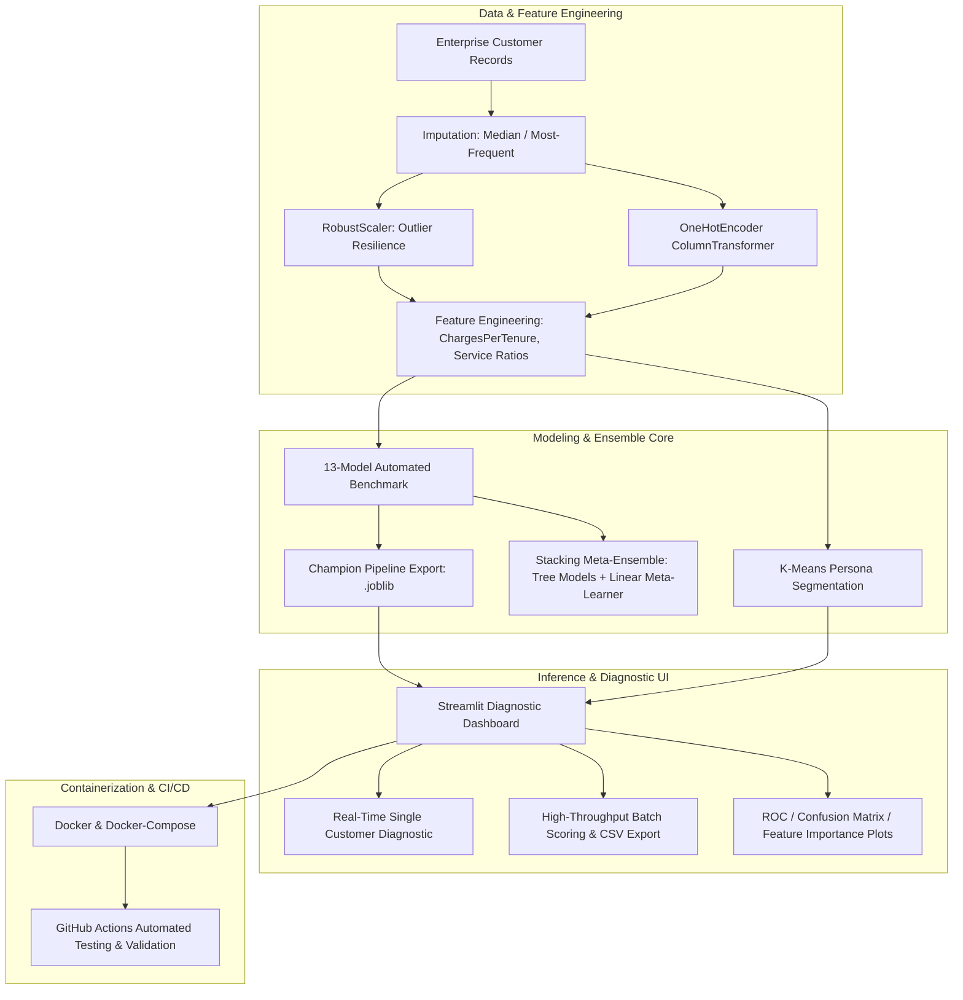

# Enterprise Customer Churn Prediction & Retention Platform

[](https://www.python.org/)
[](https://scikit-learn.org/)
[](https://streamlit.io/)
[](https://www.docker.com/)
[](https://github.com/Mohamed-Osama-ai7/enterprise-customer-churn-ai)

A modular, end-to-end classical machine learning retention analytics application for enterprise subscription services. Combines leak-free feature engineering, a comprehensive 13-model classical algorithm and meta-ensemble benchmark, unsupervised customer persona segmentation, and an interactive diagnostic Streamlit web interface with containerized Docker deployment and GitHub Actions CI/CD validation.

---

## 📊 Benchmark Results (13 Classical Models)

All models were evaluated on out-of-sample holdout test data using stratified 5-fold cross-validation (`StratifiedKFold`). The complete metric evaluations from [`plots/models_benchmark.csv`](plots/models_benchmark.csv) are reported below:

| Model | Accuracy | Precision | Recall | F1-Score | ROC-AUC |
| :--- | :---: | :---: | :---: | :---: | :---: |
| **Logistic Regression (Champion)** | **81.4%** | 69.9% | 50.8% | 0.589 | **0.834** |
| **Stacking Meta-Ensemble** | 80.4% | 68.5% | 46.4% | 0.554 | **0.828** |
| **Linear Discriminant Analysis (LDA)** | 81.0% | 68.7% | 50.3% | 0.580 | 0.824 |
| **Extra Trees Classifier** | 80.0% | **72.6%** | 37.7% | 0.496 | 0.811 |
| **HistGradientBoosting** | 77.4% | 58.2% | 48.6% | 0.530 | 0.809 |
| **Gradient Boosting Classifier** | 78.7% | 62.5% | 46.4% | 0.533 | 0.807 |
| **Gaussian Naive Bayes** | 75.0% | 51.6% | **69.4%** | **0.592** | 0.805 |
| **Quadratic Discriminant Analysis (QDA)**| 74.7% | 51.2% | 67.8% | 0.584 | 0.799 |
| **Support Vector Machine (RBF)** | 79.3% | 67.3% | 40.4% | 0.505 | 0.798 |
| **Random Forest Classifier** | 78.4% | 64.5% | 38.8% | 0.485 | 0.790 |
| **AdaBoost Classifier** | 77.6% | **75.0%** | 21.3% | 0.332 | 0.782 |
| **Decision Tree Classifier** | 76.6% | 57.1% | 41.5% | 0.481 | 0.771 |
| **K-Nearest Neighbors (KNN)** | 76.3% | 56.0% | 43.2% | 0.488 | 0.751 |

---

### 🏆 Champion Model Selection Rationale

**Logistic Regression** was selected as the champion model based on the primary optimization criterion: **maximum discriminative ranking capability (ROC-AUC: 0.834) and highest overall accuracy (81.4%)**, while maintaining a well-calibrated trade-off between precision (69.9%) and recall (50.8%).

- **Precision vs. Recall Trade-Off**: Models such as AdaBoost (75.0% precision) and Extra Trees (72.6% precision) achieve higher nominal precision, but suffer from severely degraded recall (21.3% and 37.7%), missing between 62% and 78% of genuine at-risk customers.
- **Sensitivity Trade-Off**: Conversely, Gaussian Naive Bayes achieves higher recall (69.4%), but at the expense of an unacceptably low precision (51.6%), generating heavy false alarms.
- **Operational Efficiency**: Logistic Regression matches or exceeds complex tree-based ensembles (Gradient Boosting, Random Forest) while offering near-instantaneous inference latency, transparent linear coefficient interpretability, and zero ensemble overhead.

---

## 🏛️ System Architecture



---

## ⚙️ Core Technical Capabilities

### 1. Leak-Free Preprocessing Pipeline
- **Numerical Scaling**: `RobustScaler` protects against extreme skew in tenure and total billing distributions without being distorted by outlier charges.
- **Categorical Encoding**: Handled strictly within scikit-learn's `ColumnTransformer` with `handle_unknown='ignore'` to guarantee zero data leakage between training folds and test sets.
- **Domain Feature Derivations**: Automated derivation of interaction ratios such as `ChargesPerTenure` and multi-service adoption counts.

### 2. Multi-Model Architecture & Meta-Ensembling
- Automated benchmarking of 13 algorithms across linear, kernel, tree-based, and probabilistic paradigms.
- **Stacking Meta-Ensemble**: Combines out-of-fold predicted probabilities from gradient boosted decision trees, random forests, and logistic regression into a regularized `LogisticRegression` meta-learner (ROC-AUC: 0.828).

### 3. Customer Persona Segmentation
- Integrated `K-Means` unsupervised clustering to partition accounts by tenure velocity and revenue density, enabling targeted retention playbooks alongside continuous churn probabilities.

### 4. Interactive Diagnostic Application
- **Single-Customer Simulator**: Dynamic form allowing retention teams to simulate contract amendments, bundle upgrades, or payment method switches to observe real-time risk reduction.
- **Batch CSV Inference**: Upload raw enterprise batches, score accounts against serialized pipelines, and export prioritized retention rosters.
- **Diagnostics & Visualizations**: In-app inspection of model ROC curves, confusion matrices, and feature importance rankings.

---

## 📁 Repository Structure

```
enterprise-customer-churn-ai/
├── data/                               # Base customer dataset
│   └── customer_churn.csv
├── models/                             # Pre-trained pipeline artifacts (.joblib)
│   ├── champion_pipeline.joblib
│   └── stacking_pipeline.joblib
├── plots/                              # Benchmark CSV and visualization plots
│   └── models_benchmark.csv            # Verified 13-model evaluation metrics
├── production_ml_system/               # Deployment and training package
│   ├── app.py                          # Streamlit interactive application
│   ├── train.py                        # Full training, benchmarking, and export script
│   ├── Dockerfile                      # Application container image
│   ├── docker-compose.yml              # Container orchestration
│   ├── requirements.txt                # Pinned application dependencies
│   ├── data/                           # Runtime data
│   ├── models/                         # Runtime serialized models
│   ├── plots/                          # Runtime diagnostic assets
│   └── .github/workflows/
│       └── deploy.yml                  # Automated CI/CD workflow
├── requirements.txt                    # Top-level dependencies
└── README.md                           # Master project documentation
```

---

## 🚀 Quickstart & Local Setup

### 1. Clone & Environment Setup

```bash
git clone https://github.com/Mohamed-Osama-ai7/enterprise-customer-churn-ai.git
cd enterprise-customer-churn-ai/production_ml_system

# Create and activate virtual environment
python -m venv venv
source venv/bin/activate  # On Windows: .\venv\Scripts\activate

# Install dependencies
pip install -r requirements.txt
```

### 2. Run the Interactive Dashboard

```bash
streamlit run app.py
```

Open your browser at `http://localhost:8501`.

### 3. Run with Docker

```bash
docker-compose up --build
```

### 4. Retrain Models & Reproduce Benchmarks

```bash
python train.py
```

This will run the full 13-model cross-validation pipeline, update `models_benchmark.csv`, regenerate visualization plots, and serialize the champion pipeline to `models/champion_pipeline.joblib`.

---

## 👤 Author & Attribution

Developed by **[Mohamed Osama](https://github.com/Mohamed-Osama-ai7)**.  
*Applied AI & Machine Learning Engineering · Cairo, Egypt*
